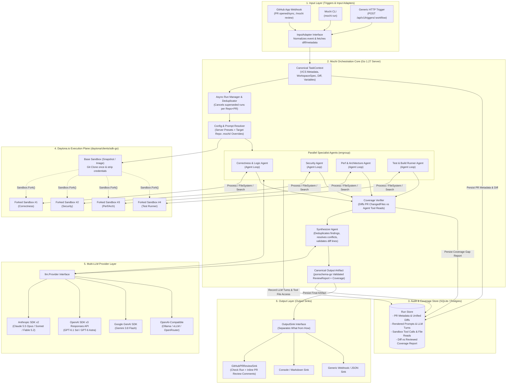
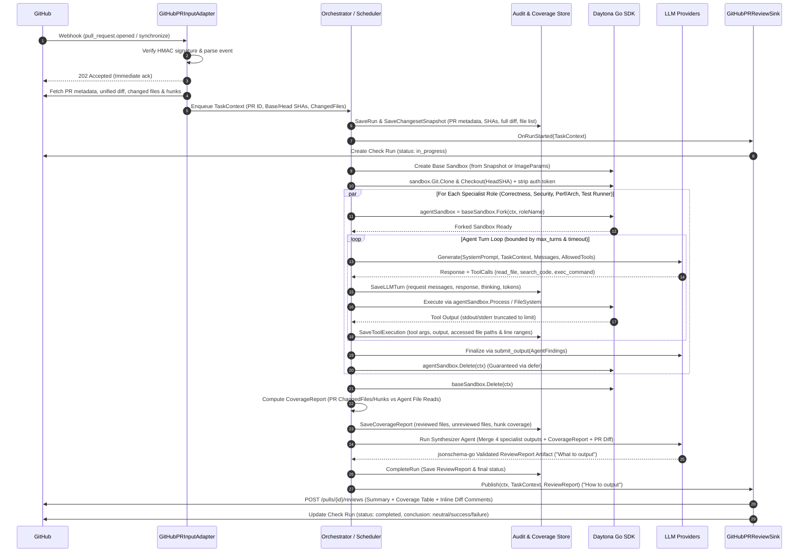
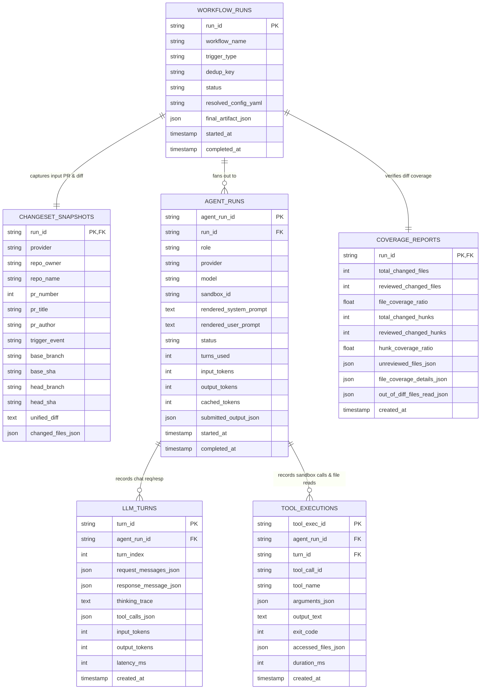

# Mochi — Tech Stack, Architecture Design & System Specification

Mochi is a **workflow-agnostic multi-agent orchestration server** written in **Go**, featuring an out-of-the-box **GitHub Pull Request Code Review** preset. It decouples trigger ingestion, agent role/prompt definitions, isolated VM execution (via **Daytona.io**), multi-provider LLM reasoning, and output formatting/delivery.

---

## 1. Core Design Principles

1. **Input Decoupling (Trigger $\rightarrow$ Canonical `TaskContext`)**: External triggers (GitHub webhooks, CLI runs, generic HTTP webhooks) are translated by **Input Adapters** into a platform-neutral `TaskContext`. Agent roles and prompt templates consume only `TaskContext`.
2. **Role & Prompt Decoupling**: Agent roles, tool permissions, LLM settings, and prompt templates live in declarative YAML + Markdown files on the server, with optional per-repository overrides via `.mochi/` in the target repository.
3. **Ephemeral Daytona.io Sandbox per Agent (with Base-Sandbox Forking)**: Each workflow run provisions a base Daytona sandbox from a Snapshot or declarative Docker image, clones the PR commit once, strips git write credentials, and calls Daytona's `Sandbox.Fork` to instantaneously give each specialist agent its own isolated VM clone. The agent loop runs inside the Mochi server while executing tools remotely via the Daytona Go SDK—keeping LLM API keys out of the VM.
4. **Native Multi-LLM Abstraction**: A unified Go `llm.Provider` interface wraps official Go SDKs for OpenAI (Responses API & Chat Completions), Anthropic, Google Gemini, and OpenAI-compatible endpoints, allowing each agent role to use the best model for its specialty.
5. **Output Separation ("What" vs. "How")**: Agents and the Synthesizer produce a strictly-typed, schema-validated artifact (`ReviewReport` — *what to output*). Pluggable **Output Sinks** (`GitHubPRReviewSink`, `ConsoleSink`, `JSONFileSink`, `WebhookSink` — *how to output*) render and publish the artifact to external systems.
6. **Full Auditability & Diff Coverage Verification**: Every run persists the exact input snapshot (PR ID, Base/Head commit SHAs, unified diff, per-file patches), every LLM request/response turn, every sandbox tool execution, and a deterministic **Review Coverage Report** that measures any gap between the PR's changed files/hunks and the files/lines agents actually inspected.

---

## 2. Verified Tech Stack (Late 2026)

| Layer | Technology / Library | Version / Package | Rationale & 2026 Verification |
| :--- | :--- | :--- | :--- |
| **Language & Runtime** | **Go** | **Go 1.27+** (`go1.27.3`) | Required by Daytona Go SDK (Go 1.25+ minimum; Go 1.23/1.24 are EOL). Includes Green Tea GC by default and `iter.Seq2` range-over-func iterators. |
| **HTTP & Webhook Server** | `net/http` + `go-chi/chi/v5` | Stdlib + `v5.2+` | Standard library routing with lightweight middleware for request logging, recovery, and webhook signature validation. |
| **CLI Framework** | `spf13/cobra` | `v1.10+` | Powers unified binary subcommands: `mochi serve`, `mochi run`, `mochi inspect`, and `mochi validate`. |
| **Configuration & Prompts** | `goccy/go-yaml` + Go `text/template` | `v1.19+` | Actively maintained YAML 1.2 parser with AST/path support (replaces `gopkg.in/yaml.v3`, which was archived in April 2025). |
| **GitHub Integration** | `google/go-github/v93` + `bradleyfalzon/ghinstallation/v2` | `v93.0+` / `v2.18+` | Official GitHub REST API v3 client (latest major v93) and GitHub App JWT / installation token rotation. |
| **Sandbox VM Management** | **Official Daytona Go SDK** | `github.com/daytona/clients/sdk-go/pkg/daytona` (`v0.231+`) | Official SDK with WebSocket state streaming and built-in `Process`, `FileSystem`, `Git`, `Lsp`, `Snapshot`, and `Sandbox.Fork` services. |
| **LLM Providers** | Official Go SDKs behind `llm.Provider`:<br>- OpenAI: `github.com/openai/openai-go/v3`<br>- Anthropic: `github.com/anthropics/anthropic-sdk-go/v2`<br>- Gemini: `google.golang.org/genai` |<br>- `v3.99+` (Responses API)<br>- `v2.7+` (Messages + Adaptive Thinking)<br>- `v1.x` (Google GenAI SDK) | Latest major versions of all three first-party Go SDKs with native tool calling, structured outputs, prompt caching, and configurable thinking effort. |
| **JSON Schema Inference & Validation** | `github.com/google/jsonschema-go` | `v0.4.3+` | Google's official Go JSON Schema library (released 2026); provides both generic Go struct schema inference (`jsonschema.For[T]()`) and fast schema validation (`Resolved.Validate`). |
| **State, Trace & Coverage Store** | `database/sql` + `modernc.org/sqlite` (default) / `jackc/pgx/v5` (optional) | `v1.59+` / `v5.x` | CGO-free embedded SQLite (with WAL mode & single-writer pool tuning) persisting PR context, diffs, LLM turns, tool calls, and diff coverage reports. |
| **Observability** | `log/slog` + OpenTelemetry (`otel`) | Stdlib + OTel Go | Correlates traces across `run_id`, `agent_role`, `sandbox_id`, and LLM calls (compatible with Daytona SDK's native OTel instrumentation). |

---

## 3. High-Level System Architecture



---

## 4. End-to-End Execution Lifecycle (PR Review Flow)



---

## 5. Core Domain Contracts & Go Interfaces

### 5.1 Input Decoupling & Changeset Context (`internal/domain/context.go`)

The core engine captures a structured snapshot of the VCS/PR metadata and exact diff hunks in `TaskContext` so that prompts, output sinks, and the audit/coverage store have complete context without coupling to the GitHub API client:

```go
package domain

import "context"

// TaskContext is the canonical, platform-neutral input to any workflow.
type TaskContext struct {
    RunID        string         `json:"run_id"`
    WorkflowName string         `json:"workflow_name"`
    TriggerType  string         `json:"trigger_type"`  // e.g. "github_pr", "cli", "webhook"
    DedupKey     string         `json:"dedup_key"`     // e.g. "github:owner/repo:pr:42"
    Workspace    WorkspaceSpec  `json:"workspace"`     // How Daytona should prepare the codebase
    Changeset    *ChangesetSpec `json:"changeset"`     // Structured PR/commit metadata, diff, and changed files
    Variables    map[string]any `json:"variables"`     // Exposed to Go text/template prompts
    SinkMetadata map[string]any `json:"sink_metadata"` // Routing metadata for the OutputSink
}

type WorkspaceSpec struct {
    RepoURL    string `json:"repo_url"`
    Ref        string `json:"ref"`                  // Head Commit SHA or branch
    BaseRef    string `json:"base_ref"`             // Base branch/SHA for diffs
    CloneToken string `json:"-"`                    // Ephemeral read-only token (never logged or persisted)
    Snapshot   string `json:"snapshot,omitempty"`   // Daytona Snapshot name/ID (fastest ~90ms boot)
    Image      string `json:"image,omitempty"`      // Optional Docker image override
    Dockerfile string `json:"dockerfile,omitempty"` // Optional path to Dockerfile in repo
}

// ChangesetSpec records the exact VCS / Pull Request state at trigger time.
type ChangesetSpec struct {
    Provider       string        `json:"provider"`                  // "github", "git_local", etc.
    RepoOwner      string        `json:"repo_owner"`                // e.g. "shohei-yamagiwa"
    RepoName       string        `json:"repo_name"`                 // e.g. "mochi"
    PRNumber       int           `json:"pr_number,omitempty"`       // Pull Request number (e.g. 42)
    PRURL          string        `json:"pr_url,omitempty"`
    Title          string        `json:"title"`
    Description    string        `json:"description"`
    Author         string        `json:"author"`
    TriggerEvent   string        `json:"trigger_event"`             // e.g. "pull_request.synchronize"
    InstallationID int64         `json:"installation_id,omitempty"` // GitHub App Installation ID
    BaseBranch     string        `json:"base_branch"`               // e.g. "main"
    BaseSHA        string        `json:"base_sha"`                  // Exact base commit SHA
    HeadBranch     string        `json:"head_branch"`               // e.g. "feat/daytona-fork"
    HeadSHA        string        `json:"head_sha"`                  // Exact head commit SHA reviewed
    UnifiedDiff    string        `json:"unified_diff"`              // Full unified diff across the PR
    ChangedFiles   []ChangedFile `json:"changed_files"`             // Per-file patches and line ranges
}

type ChangedFile struct {
    Path         string      `json:"path"`
    PreviousPath string      `json:"previous_path,omitempty"` // Set when status == "renamed"
    Status       string      `json:"status"`                  // "added", "modified", "deleted", "renamed"
    Additions    int         `json:"additions"`
    Deletions    int         `json:"deletions"`
    Patch        string      `json:"patch"`                   // File-specific unified diff patch
    ChangedHunks []LineRange `json:"changed_hunks"`           // New-file line ranges modified in the diff
}

type LineRange struct {
    StartLine int `json:"start_line"`
    EndLine   int `json:"end_line"`
}

type InputAdapter interface {
    Name() string
    BuildTaskContext(ctx context.Context, rawEvent any) (*TaskContext, error)
}
```

### 5.2 Daytona Sandbox Abstraction (`internal/sandbox`)

Mochi wraps the official Daytona Go SDK (`github.com/daytona/clients/sdk-go/pkg/daytona`) in a clean domain interface supporting `Process`, `FileSystem`, native `SearchFiles`, and `Fork`:

```go
package sandbox

import (
    "context"
    "time"
)

type CreateOptions struct {
    Name           string
    Workspace      domain.WorkspaceSpec
    EnvVars        map[string]string
    ResourceLimits ResourceLimits
}

type ExecRequest struct {
    Command string
    WorkDir string
    Timeout time.Duration
}

type ExecResult struct {
    ExitCode int    `json:"exit_code"`
    Stdout   string `json:"stdout"`
    Stderr   string `json:"stderr"`
    TimedOut bool   `json:"timed_out"`
}

type Sandbox interface {
    ID() string
    // Fork clones the current Sandbox state into a new isolated Sandbox VM for parallel agents.
    Fork(ctx context.Context, name string) (Sandbox, error)
    // Exec runs a command via daytona.Sandbox.Process.ExecuteCommand
    Exec(ctx context.Context, req ExecRequest) (*ExecResult, error)
    // File & search operations backed by daytona.Sandbox.FileSystem
    ReadFile(ctx context.Context, path string, startLine, endLine int) (string, error)
    WriteFile(ctx context.Context, path string, content []byte) error
    ListDir(ctx context.Context, path string) ([]FileEntry, error)
    SearchFiles(ctx context.Context, rootPath, pattern string) ([]SearchMatch, error)
    // Destroy calls daytona.Sandbox.Delete(ctx)
    Destroy(ctx context.Context) error
}

type Provider interface {
    CreateAndPrepareBaseSandbox(ctx context.Context, opts CreateOptions) (Sandbox, error)
}
```

### 5.3 Multi-LLM Provider Interface (`internal/llm`)

Each agent role specifies its own `provider`, `model`, and `reasoning_effort`. Mochi normalizes messages, tool definitions, prompt caching, and structured outputs across OpenAI Responses API (`v3`), Anthropic Messages API (`v2`), and Google GenAI:

```go
package llm

import "context"

type ModelConfig struct {
    Provider        string   `yaml:"provider"`                   // "anthropic", "openai", "gemini", "openai_compat"
    Model           string   `yaml:"model"`                      // e.g. "claude-sonnet-5-5", "gpt-6.1-sol", "gemini-3.8-flash"
    Temperature     *float64 `yaml:"temperature,omitempty"`
    MaxOutputTokens int      `yaml:"max_output_tokens,omitempty"`
    ReasoningEffort string   `yaml:"reasoning_effort,omitempty"` // "minimal", "low", "medium", "high"
}

type ChatRequest struct {
    Config       ModelConfig
    SystemPrompt string
    Messages     []Message
    Tools        []ToolDefinition
    ToolChoice   string // "auto", "required", or specific tool name (e.g. "submit_output")
}

type ChatResponse struct {
    Message      Message
    Thinking     string // Captured reasoning/thinking summary when returned by the provider
    ToolCalls    []ToolCall
    Usage        TokenUsage
    FinishReason string
}

type Provider interface {
    Name() string
    Generate(ctx context.Context, req ChatRequest) (*ChatResponse, error)
}
```

### 5.4 Output Decoupling: "What to Output" vs. "How to Output" (`internal/output`)

#### "What to Output" — Canonical `ReviewReport` Artifact
Using `github.com/google/jsonschema-go`, Mochi automatically derives the JSON Schema directly from the `ReviewReport` Go struct (`jsonschema.For[ReviewReport]()`) and validates the Synthesizer's output via `resolvedSchema.Validate(...)`. It also embeds the deterministic `CoverageReport` so downstream sinks can display review coverage:

```go
package output

type Verdict string

const (
    VerdictApprove        Verdict = "APPROVE"
    VerdictRequestChanges Verdict = "REQUEST_CHANGES"
    VerdictComment        Verdict = "COMMENT"
)

type Severity string

const (
    SeverityCritical Severity = "critical"
    SeverityHigh     Severity = "high"
    SeverityMedium   Severity = "medium"
    SeverityLow      Severity = "low"
    SeverityNit      Severity = "nit"
)

// ReviewReport represents "What to output" for code review workflows.
type ReviewReport struct {
    Summary        string                 `json:"summary" jsonschema:"Executive summary of the code review"`
    Verdict        Verdict                `json:"verdict" jsonschema:"Overall review verdict: APPROVE, REQUEST_CHANGES, or COMMENT"`
    Findings       []Finding              `json:"findings" jsonschema:"Deduplicated list of code review findings"`
    TestExecution  *TestSummary           `json:"test_execution,omitempty" jsonschema:"Summary of build and test execution inside Daytona"`
    Coverage       *domain.CoverageReport `json:"coverage,omitempty" jsonschema:"Deterministic verification of PR diff files vs files inspected by agents"`
    AgentSummaries map[string]string      `json:"agent_summaries,omitempty" jsonschema:"Per-role summary from each specialist agent"`
}

type Finding struct {
    FilePath       string   `json:"file_path" jsonschema:"Repository-relative file path"`
    StartLine      int      `json:"start_line,omitempty" jsonschema:"1-indexed start line in the new file"`
    EndLine        int      `json:"end_line,omitempty" jsonschema:"1-indexed end line in the new file"`
    Severity       Severity `json:"severity" jsonschema:"Severity: critical, high, medium, low, or nit"`
    Category       string   `json:"category" jsonschema:"Category: correctness, security, performance, architecture, or testing"`
    Title          string   `json:"title" jsonschema:"Concise one-line title of the finding"`
    Description    string   `json:"description" jsonschema:"Detailed explanation and impact"`
    SuggestionCode string   `json:"suggestion_code,omitempty" jsonschema:"Exact replacement code snippet for the line range"`
    Confidence     float64  `json:"confidence" jsonschema:"Confidence score between 0.0 and 1.0"`
    SourceAgents   []string `json:"source_agents" jsonschema:"Specialist agent roles that reported this finding"`
}
```

#### "How to Output" — `OutputSink` Interface

```go
package output

import (
    "context"
    "encoding/json"
)

type OutputSink interface {
    Name() string
    // OnRunStarted is called when a workflow begins (e.g. creates an in-progress GitHub Check Run).
    OnRunStarted(ctx context.Context, task *domain.TaskContext) error
    // Publish formats and delivers the final workflow artifact to the target destination.
    Publish(ctx context.Context, task *domain.TaskContext, artifact json.RawMessage) error
    // OnRunFailed reports unrecoverable workflow errors or cancellations.
    OnRunFailed(ctx context.Context, task *domain.TaskContext, err error) error
}
```

---

## 6. Persistence, Audit Logging & Diff Coverage Verification (`internal/store`)

To verify whether there is any gap between the **actual PR diff** and **what the agents actually inspected**, Mochi records four linked layers of data for every workflow run in SQLite (or PostgreSQL):

### 6.1 Database Schema & Recorded Entities



### 6.2 How Diff Coverage Verification Works (`internal/orchestrator/coverage.go`)

1. **Ground-Truth Diff Baseline (`CHANGESET_SNAPSHOTS`)**:
   When a PR webhook arrives, `GitHubPRInputAdapter` records the exact `pr_number`, `base_sha`, `head_sha`, `unified_diff`, and `changed_files` (including each file's modified line ranges `ChangedHunks` in the new file).
2. **Automatic File-Access Instrumentation in Sandbox Tools (`TOOL_EXECUTIONS.accessed_files_json`)**:
   Every sandbox tool wrapper automatically extracts and logs structured file access events (`FileAccessRecord`) whenever an agent interacts with the repository:
   - `read_file(path, start_line, end_line)` $\rightarrow$ records `path` and `[start_line, end_line]` read by `role`.
   - `git_diff(path)` $\rightarrow$ records `path` (or all changed files if unfiltered) inspected by `role`.
   - `search_code(path, pattern)` $\rightarrow$ records matched file paths and line numbers returned to `role`.
   - `submit_output(findings)` $\rightarrow$ records `file_path` and `[start_line, end_line]` cited in findings by `role`.
3. **Deterministic Gap Calculation (`CoverageReport`)**:
   Before invoking the Synthesizer, Mochi computes `domain.CoverageReport`:

```go
package domain

type CoverageReport struct {
    RunID                string               `json:"run_id"`
    PRNumber             int                  `json:"pr_number,omitempty"`
    BaseSHA              string               `json:"base_sha"`
    HeadSHA              string               `json:"head_sha"`
    TotalChangedFiles    int                  `json:"total_changed_files"`
    ReviewedChangedFiles int                  `json:"reviewed_changed_files"`
    FileCoverageRatio    float64              `json:"file_coverage_ratio"` // 0.0 - 1.0
    TotalChangedHunks    int                  `json:"total_changed_hunks"`
    ReviewedChangedHunks int                  `json:"reviewed_changed_hunks"`
    HunkCoverageRatio    float64              `json:"hunk_coverage_ratio"` // 0.0 - 1.0
    UnreviewedFiles      []string             `json:"unreviewed_files"`    // Changed in PR diff, but no agent inspected them
    FileDetails          []FileCoverageDetail `json:"file_details"`        // Per-file breakdown
    ContextFilesRead     []string             `json:"context_files_read"`  // Unchanged files read by agents for surrounding context
}

type FileCoverageDetail struct {
    Path              string                 `json:"path"`
    ChangeStatus      string                 `json:"change_status"`        // "added", "modified", "deleted", "renamed"
    ChangedHunks      []LineRange            `json:"changed_hunks"`        // Line ranges modified in PR
    ReadRangesByAgent map[string][]LineRange `json:"read_ranges_by_agent"` // Role -> line ranges read
    InspectedByAgents []string               `json:"inspected_by_agents"`  // Which specialist roles examined this file
    UncoveredHunks    []LineRange            `json:"uncovered_hunks"`      // Changed hunks not overlapped by any read_file / diff
    FindingsCount     int                    `json:"findings_count"`
}
```

4. **Surfacing & Querying the Coverage Gap**:
   - **In the Synthesizer**: The `CoverageReport` is passed to the Synthesizer prompt so it is explicitly aware if any changed files or hunks were missed by specialist agents.
   - **In GitHub PR Reviews / Check Runs**: `GitHubPRReviewSink` includes a collapsible **Review Coverage (`X/Y files, Z% hunks inspected at commit <short_sha>`)** table in the Check Run and PR Review summary, explicitly listing any `unreviewed_files` if coverage is `< 100%`.
   - **Via CLI & API**:
     - `mochi inspect <run_id>` prints the stored PR metadata (`PR #42`, `base_sha..head_sha`), per-agent LLM turns, tool calls, and the file-by-file diff coverage matrix.
     - `GET /api/v1/runs/{run_id}` and `GET /api/v1/runs/{run_id}/coverage` return the full stored snapshot, LLM messages, and coverage report as JSON.

---

## 7. Declarative Configuration & Prompt Architecture

### 7.1 Server Workflow Configuration (`configs/workflows/pr-review.yaml`)

```yaml
version: "1"
name: pr-review
description: Multi-agent PR code review with isolated Daytona sandbox verification

input:
  adapter: github_pr
  triggers:
    events: ["opened", "synchronize", "reopened", "ready_for_review"]
    comment_command: "/mochi review"
    ignore_drafts: true

repo_overrides:
  enabled: true
  path: ".mochi/config.yaml"
  allow_custom_prompts: true
  allow_custom_images: false # Security control: prevent untrusted PRs from running arbitrary container images

sandbox:
  provider: daytona
  default_snapshot: "mochi-default-polyglot" # Or fallback to default_image
  default_image: "ubuntu:24.04"
  fork_from_base: true # Clone repo once in base sandbox and fork per specialist agent
  setup_timeout: 3m

agents:
  - role: correctness
    prompt_file: "configs/prompts/correctness.md"
    llm:
      provider: anthropic
      model: claude-sonnet-5-5
      reasoning_effort: high
    sandbox:
      enabled: true
    tools: ["read_file", "list_dir", "search_code", "git_diff", "exec_command", "submit_output"]
    budgets:
      max_turns: 15
      max_tokens: 120000
      command_timeout: 60s
      run_timeout: 5m

  - role: security
    prompt_file: "configs/prompts/security.md"
    llm:
      provider: anthropic
      model: claude-opus-5-5
      reasoning_effort: high
    sandbox:
      enabled: true
    tools: ["read_file", "list_dir", "search_code", "git_diff", "exec_command", "submit_output"]
    budgets:
      max_turns: 15
      max_tokens: 120000
      command_timeout: 60s
      run_timeout: 5m

  - role: performance-architecture
    prompt_file: "configs/prompts/performance_architecture.md"
    llm:
      provider: gemini
      model: gemini-3.8-flash
      reasoning_effort: high
    sandbox:
      enabled: true
    tools: ["read_file", "list_dir", "search_code", "git_diff", "exec_command", "submit_output"]
    budgets:
      max_turns: 12
      max_tokens: 150000
      command_timeout: 60s
      run_timeout: 5m

  - role: test-runner
    prompt_file: "configs/prompts/test_runner.md"
    llm:
      provider: openai
      model: gpt-6.1-sol
      reasoning_effort: medium
    sandbox:
      enabled: true
    tools: ["read_file", "write_file", "list_dir", "search_code", "git_diff", "exec_command", "submit_output"]
    budgets:
      max_turns: 20
      max_tokens: 150000
      command_timeout: 180s
      run_timeout: 8m

synthesizer:
  prompt_file: "configs/prompts/synthesizer.md"
  llm:
    provider: openai
    model: gpt-6.1-sol
    reasoning_effort: medium
  budgets:
    run_timeout: 2m

output:
  sinks:
    - type: github_pr_review
      post_inline_comments: true
      include_coverage_summary: true
      min_severity: "low"
      min_confidence: 0.7
      verdict_mode: "comment_only" # or "enforce" to allow REQUEST_CHANGES / APPROVE
```

---

## 8. Repository Directory Layout

```text
mochi/
├── cmd/
│   └── mochi/
│       └── main.go                  # Entrypoint: `mochi serve`, `mochi run`, `mochi inspect`, `mochi validate`
├── configs/
│   ├── workflows/
│   │   └── pr-review.yaml           # Default PR Review workflow preset
│   └── prompts/
│       ├── correctness.md
│       ├── security.md
│       ├── performance_architecture.md
│       ├── test_runner.md
│       └── synthesizer.md
├── internal/
│   ├── domain/                      # Core workflow-agnostic entities & interfaces
│   │   ├── context.go               # TaskContext, WorkspaceSpec, ChangesetSpec, ChangedFile
│   │   ├── workflow.go              # Workflow, RoleConfig, BudgetConfig
│   │   ├── run.go                   # RunRecord, AgentRunRecord, LLMTurnRecord, ToolExecRecord
│   │   └── coverage.go              # CoverageReport, FileCoverageDetail, FileAccessRecord
│   ├── config/                      # YAML loader (goccy/go-yaml), prompt template renderer, .mochi/ merger
│   ├── input/                       # Input Adapters (Trigger -> TaskContext)
│   │   ├── adapter.go
│   │   ├── github/                  # GitHub App webhook handler, unified diff/hunk parser (go-github/v93)
│   │   ├── cli/                     # Local git / PR URL input adapter for `mochi run`
│   │   └── webhook/                 # Generic JSON webhook adapter
│   ├── orchestrator/                # Execution engine
│   │   ├── scheduler.go             # Async worker pool & per-DedupKey run cancellation
│   │   ├── runner.go                # Base sandbox prep + Parallel fan-out (Fork + errgroup) + Synthesizer
│   │   ├── agent_loop.go            # Multi-turn LLM <-> Sandbox tool loop with turn/tool persistence
│   │   └── coverage.go              # Computes CoverageReport comparing PR ChangedFiles vs ToolExecutions
│   ├── sandbox/                     # VM Sandbox layer
│   │   ├── sandbox.go               # Sandbox & Provider interfaces
│   │   └── daytona/                 # Official Daytona Go SDK adapter (daytona/clients/sdk-go)
│   ├── tools/                       # Role-scoped tools wired to a Sandbox instance (emits FileAccessRecords)
│   │   ├── registry.go
│   │   ├── exec_command.go
│   │   ├── file_ops.go              # read_file, write_file, list_dir
│   │   ├── search_code.go           # Backed by Daytona FileSystem.SearchFiles / ripgrep
│   │   ├── git_diff.go
│   │   └── submit_output.go         # Validates output via google/jsonschema-go & terminates loop
│   ├── llm/                         # Multi-provider LLM layer
│   │   ├── provider.go              # Unified Provider interface & Registry
│   │   ├── openai/                  # OpenAI SDK v3 (Responses API + Chat Completions compat)
│   │   ├── anthropic/               # Anthropic SDK v2 (Messages API + Adaptive Thinking)
│   │   └── gemini/                  # Google GenAI SDK (google.golang.org/genai)
│   ├── output/                      # Output Sinks ("What" -> "How")
│   │   ├── sink.go                  # OutputSink interface & ReviewReport types
│   │   ├── github/                  # GitHub PR Review + Check Run publisher & diff line mapper
│   │   ├── console/                 # Terminal Markdown renderer
│   │   └── webhook/                 # Outbound webhook publisher
│   ├── store/                       # Persistence layer
│   │   ├── store.go                 # Store interface (Runs, Changesets, Turns, ToolExecs, Coverage)
│   │   └── sqlite/                  # Embedded SQLite implementation (modernc.org/sqlite, WAL enabled)
│   └── server/                      # HTTP server & API routes (webhooks + /api/v1/runs inspection endpoints)
│       └── server.go
├── docs/
│   └── architecture.md
├── go.mod
└── README.md
```

---

## 9. Security & Operational Guardrails

1. **Zero LLM Keys in Sandboxes**: The LLM loop executes inside the Mochi server process; Daytona VMs only receive tool invocations (`Process.ExecuteCommand`, `FileSystem.DownloadFile`, etc.).
2. **Read-Only Ephemeral Git Credentials**: GitHub installation tokens used to clone PR branches are scoped to read-only repository contents during cloning in the base sandbox, and stripped from `.git/config` immediately after `git checkout` *before* forking agent sandboxes so untrusted code or tests cannot push back to the repository or read the token. `CloneToken` is tagged `json:"-"` so it is never written to `CHANGESET_SNAPSHOTS` or logs.
3. **Untrusted PR Protection**: When evaluating a PR from a fork or untrusted branch, `.mochi/` overrides in the target repo are read from the **base branch** (e.g., `main`) by default so a malicious PR cannot alter system prompts or sandbox images to exfiltrate data.
4. **Per-Agent Budgets & Guaranteed Cleanup**:
   - Every agent loop enforces `max_turns`, `max_tokens`, `command_timeout`, and `run_timeout` via Go `context.WithTimeout`.
   - `stdout`/`stderr` from `exec_command` are capped (e.g., 32 KB head+tail truncation) to prevent context window exhaustion.
   - Every forked and base Daytona sandbox is torn down in a `defer` block with a detached cleanup context (`context.WithoutCancel`) plus `SetAutoDeleteInterval` as a server-side fail-safe so crashed or cancelled runs never leak running VMs.

---

## 10. Phased Implementation Plan

- **Phase 1 — Foundation, Domain Contracts & Audit Store**: Initialize Go 1.27 module, core domain interfaces (`TaskContext`, `ChangesetSpec`, `CoverageReport`, `InputAdapter`, `Sandbox`, `llm.Provider`, `OutputSink`), YAML workflow/role config loader (`goccy/go-yaml`), Go `text/template` prompt engine, `google/jsonschema-go` schema validator, and the SQLite store (`workflow_runs`, `changeset_snapshots`, `agent_runs`, `llm_turns`, `tool_executions`, `coverage_reports`).
- **Phase 2 — Multi-LLM & Daytona Sandbox Layer**: Implement the OpenAI (`v3` Responses API), Anthropic (`v2`), and Gemini (`google.golang.org/genai`) adapters; integrate the official Daytona Go SDK (`daytona/clients/sdk-go`) supporting base sandbox setup + `Fork`; implement the role-scoped sandbox tools (with `FileAccessRecord` tracking) and the multi-turn `AgentLoop` with full turn/tool persistence and budget guardrails.
- **Phase 3 — Orchestrator, Coverage Verifier & Default PR Review Preset**: Build the parallel fan-out + Coverage Verifier (`coverage.go`) + Synthesizer orchestrator (`errgroup` + per-PR cancellation scheduler) and author the 4 specialist prompts (`correctness`, `security`, `performance-architecture`, `test-runner`) + `synthesizer` prompt.
- **Phase 4 — Input Adapters, Output Sinks & CLI**: Implement the GitHub App `InputAdapter` (`go-github/v93` webhooks + unified diff/hunk parser + `/mochi review` command) and `GitHubPRReviewSink` (Check Runs + coverage summary + diff-mapped inline review comments), plus the `mochi serve`, `mochi run`, `mochi inspect`, and `mochi validate` CLI commands.
